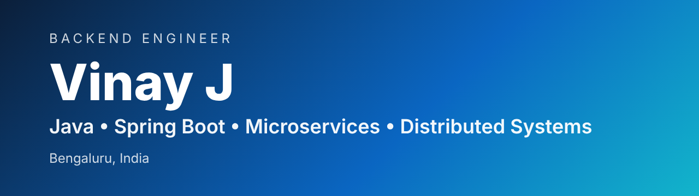

  

  
  
  

## 👋 About me

Backend engineer with **3.5+ years** of experience building scalable, secure and reliable enterprise services in **Java and Spring Boot**. I design REST APIs and microservices, model relational data, build event-driven systems, and ship through CI/CD pipelines on cloud platforms.

- 🏗️ Designed **100+ REST/OData services** and modeled **50+ entities** across 10 modules for an enterprise Oil & Gas platform
- ⚡ Cut API response time by **~50%** through query and data-model tuning
- 📨 Built event-driven processing with **Kafka**, handling hundreds of events per day
- 🔐 Implemented **OAuth2 / JWT** based security and service-to-service integrations
- 🧵 Built concurrency-safe calculation frameworks with `CompletableFuture` and `ExecutorService`
- 🤝 Mentored 10+ junior engineers and contributed to design reviews
- 📍 Bengaluru, India · open to remote

## 🛠️ Tech stack

**Languages & frameworks**

**Architecture & messaging**

**Data**

**Cloud, DevOps & testing**

**Enterprise platform experience:** SAP BTP, SAP CAP (Java), SAP HANA Cloud, S/4HANA integration, XSUAA.

## 🚀 Featured work

| Project | What it is | Tech |
|---|---|---|
| **[Portfolio + CAP Store demo](https://vinay72368.github.io/portfolio/)** | Personal portfolio with a live full-stack sample store: stock checks, volume discounts and a callable OData API | Java, CAP, OData V4, UI5, JUnit |
| **Asset Integrity Management Platform** | Enterprise Oil & Gas platform with 100+ REST/OData services bridging S/4HANA and the database, with event-driven workflows | Java, Spring Boot, Kafka, HANA, OAuth2/JWT |
| **Maintenance Recommendation Engine** | Extensible rule-based engine with modular services and async processing, separating computation from request-response flows | Java, Spring Boot, PostgreSQL, JPA, Kafka |
| **Maintenance Spend Planning** | Budget-planning workflows with persistence, validation rules and approval-stage calculations | Java, Spring Boot, PostgreSQL, JPA |

_Enterprise projects are private to my employer; the portfolio has write-ups and a live demo._

## 📫 Let's connect

- 🌐 Portfolio: [vinay72368.github.io/portfolio](https://vinay72368.github.io/portfolio/)
- 💼 LinkedIn: [Vinay J](https://linkedin.com/in/vinay-j-a44375179)
- ✉️ Email: [jujarayvinay1210@gmail.com](mailto:jujarayvinay1210@gmail.com)

